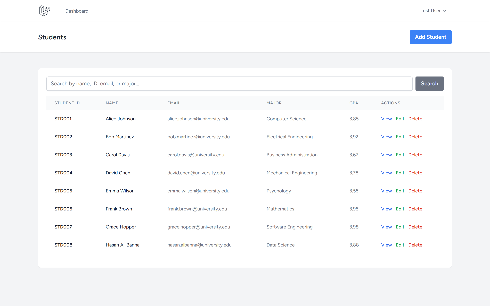
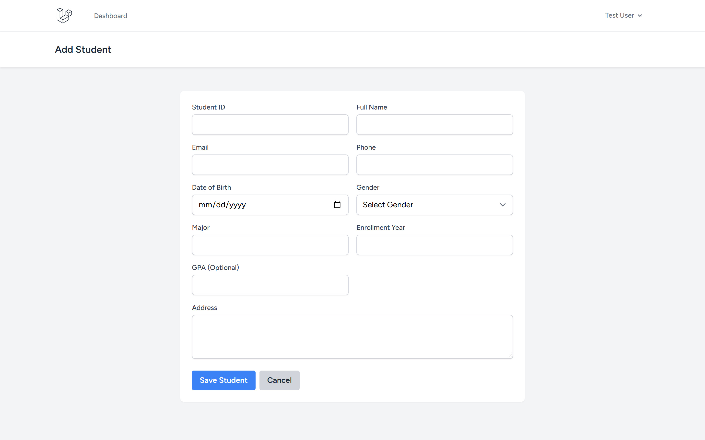
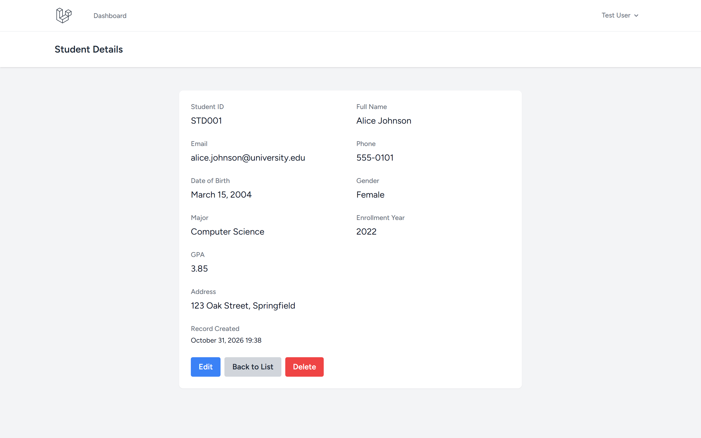
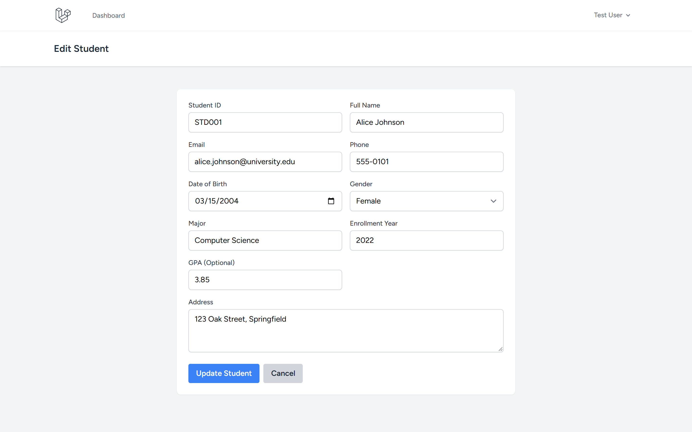

# Student CRUD Application

A comprehensive Laravel-based student management system with full CRUD operations, search functionality, and validation.

Repository: https://github.com/0xyz-exe/student-crud-app-laravel

## Screenshots

| Tampilan | Preview |
|---|---|
| **Direktori Mahasiswa & Pencarian Terpadu**<br>Tabel master data mahasiswa lengkap dengan kolom Student ID, Nama, Email Kampus, Jurusan, IPK/GPA, fitur pencarian multi-parameter, dan aksi langsung |  |
| **Formulir Pendaftaran Mahasiswa Baru**<br>Formulir pendaftaran mahasiswa baru dengan validasi field identitas, tanggal lahir, jenis kelamin, jurusan akademik, tahun angkatan, dan alamat tinggal |  |
| **Detail Profil Akademik Mahasiswa**<br>Halaman ringkasan profil mahasiswa komprehensif menampilkan data diri, riwayat pendaftaran, capaian IPK kumulatif, serta tombol tindakan kelola |  |
| **Manajemen & Pembaruan Data Mahasiswa**<br>Formulir edit data mahasiswa terisi otomatis (pre-filled) dengan validasi integritas unik NIM/ID dan email untuk pembaruan profil berkala |  |

## Features

- ✅ User authentication (Laravel Breeze)
- ✅ Complete CRUD operations for students
- ✅ Search by name, ID, email, or major
- ✅ Detailed student profiles
- ✅ Form validation
- ✅ Responsive table layout
- ✅ Pagination

## Tech Stack

- Laravel 13.38.0
- Laravel Breeze 2.4
- SQLite
- Tailwind CSS

## Installation

```bash
# Clone repository
git clone https://github.com/0xyz-exe/student-crud-app-laravel.git
cd student-crud-app-laravel

# Install dependencies
composer install
npm install && npm run build

# Setup environment
cp .env.example .env
php artisan key:generate

# Create database
touch database/database.sqlite

# Run migrations with demo data
php artisan migrate --seed

# Start server
php artisan serve
```

Visit `http://localhost:8000`

## Demo Account

- Email: `test@example.com`
- Password: `password`

## Database Schema

**students**
- id
- student_id (unique)
- name
- email (unique)
- phone (nullable)
- date_of_birth
- gender (Male/Female)
- address
- major
- enrollment_year
- gpa (0-4, nullable)
- timestamps

## Usage

1. **Login** with demo account
2. **View Students** - Browse all student records with search
3. **Add Student** - Create new student with full validation
4. **View Details** - See complete student profile
5. **Edit Student** - Update existing records
6. **Delete Student** - Remove records with confirmation

## Search

Search across multiple fields:
- Student ID
- Name
- Email
- Major

## Validation

- Unique student ID and email
- Valid email format
- Date of birth must be in the past
- GPA range: 0-4
- Phone number format
- Required fields enforced

## Security

- User authentication required
- CSRF protection
- Input validation
- SQL injection prevention
- XSS protection

## License

MIT
